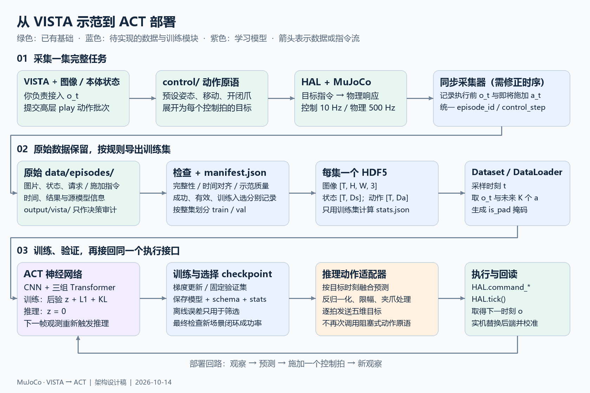
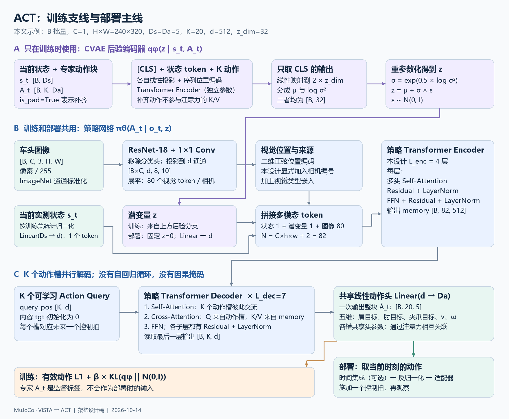
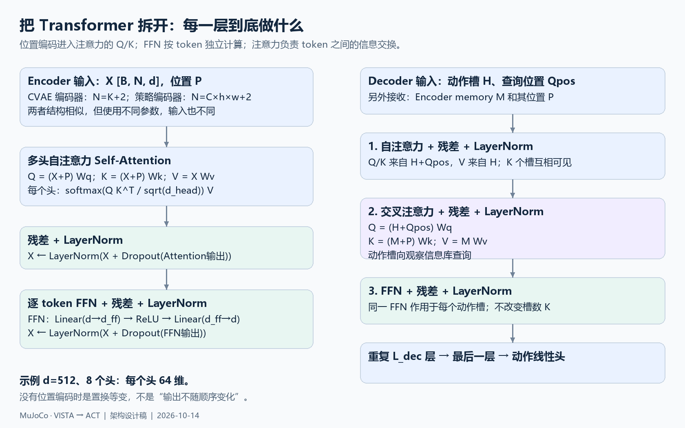

# ACT：从 VISTA 示范到移动机械臂策略

设计日期：2026-10-14。依据当前仓库、你的《10.13 ACT.pdf》和 ACT 原论文/实现整理。

**我们要训练的是：输入车头图像和机器人实测状态，一次预测未来一段底层控制目标的 ACT 策略。** VISTA 负责产生示范；ACT 学习示范，部署后直接通过 HAL 逐拍控制机器人。

本文包含已实现的数据采集契约，以及尚未落地的 ACT 网络、训练和部署蓝图。VISTA 已接入五维本体状态；`recorder.py` 已实现执行前采样、完整成功集 HDF5、持续追加的 manifest 和崩溃恢复。第 8 节仍是教学代码，未进行 PyTorch 训练验证。

推荐阅读顺序：先看第 1、3、6 节的图，再看第 4～5 节的数据，最后看第 8 节的代码。

## 1. 最终项目要怎样连起来



[可缩放的 SVG 原图](assets/act/project-flow.svg)

一次完整流程是：

1. VISTA 看图像和状态，提出高层动作；现有 `control/` 把动作展开为每个控制拍的底层命令。
2. 采集器记录执行前观测、随后的实际施加命令、时间和结果，保留所有原始 episode。
3. 采集开始先登记排除条目；完成后依据完整性与最终环境成功判定更新 `manifest.json`。不做行为质量评分，不裁剪片段。
4. 每个完整成功 episode 立即导出一个 HDF5。采集阶段不划分 train/val；准备训练时冻结数据集，按 episode/场景划分，再仅用训练集计算统计量。
5. Dataset 从某集抽取时刻 `t`，得到 `o_t` 和未来 `K` 拍动作块，训练 ACT。
6. 部署时输入新观测，预测动作块，取当前拍的动作，通过 HAL 执行一拍，再取新观测。

`control/` 的示范生成逻辑可以保留。需要补的是采集时序、数据处理模块和 ACT 推理适配器。**不能把 ACT 每拍的输出再次交给会运行多拍的 `forward(seconds)` 或 `arm_pose(...)`**，否则动作频率和训练标签会不一致。

## 2. 你的理解：哪些保留，哪些需要调整

你的核心理解是正确的：ACT 属于行为克隆；预测的是动作块；训练时有 CVAE 后验编码器；部署时取 `z=0`；Decoder 用多个可学习 query 并行预测未来动作。这些构成本设计的主线。

| 附件中的概念 | 本文采用的解释与修正 |
| --- | --- |
| `o_t`、关节坐标、`a_t`（第 6～7 页） | `o_t = {图像 I_t, 实测状态 s_t}`；`a_t` 是随后施加的控制目标。给 VISTA 增加关节反馈，主要是增加 `s_t`，不能用目标代替实测值。上一拍命令可以额外提供，但必须单独命名。 |
| 状态与动作的维度（第 7 页） | 本文暂定 `Ds=Da=5`，但两者没有必须相等或 `Ds >= Da` 的数学要求。状态要足以判断如何行动；信息是否充分不能只靠数字维度判断。 |
| padding mask（第 2、6 页） | “1 有效、0 补齐”可以作为 `valid_mask` 的定义；但原 ACT 的 `is_pad=True` 表示补齐。本文始终采用 `valid = ~is_pad`，避免把两套约定混用。 |
| 没有位置编码时顺序不影响结果（第 3 页） | 更准确是自注意力具有**置换等变性**：输入 token 重排，输出也相应重排；不是输出完全不变。 |
| CNN 的作用（第 3 页） | 使用去掉分类头的 ResNet-18，保留空间特征图；卷积残差块不是统一意义上的“卷积后接 MLP”。投影到 Transformer 维度由 `1×1 Conv` 完成。 |
| Decoder 只需一层交叉注意力（第 5 页） | 不能直接断言一层足够。原项目训练配置使用多层 Decoder；本文示例为 7 层，每层包含自注意力、交叉注意力和 FFN。 |
| 图像归一化（第 3 页） | 使用预训练 ResNet 时，本文采用像素除以 255，再做 ImageNet 通道标准化；状态和动作另用训练集统计量归一化。不是所有输入都共用一套均值方差。 |
| 时间集成优先旧预测（第 2 页） | 你写的旧到新 `exp(-m*i)` 与原实现的顺序一致。但“旧预测一定更可靠”不是定理，权重大也可能增加切换延迟，要用闭环实验判断。 |
| `z=0` 的含义（第 6 页） | 它是标准正态先验的均值，是确定性的推理选择；不能保证它代表“最常见且最优的示范风格”。 |
| 相邻帧目标与当前位置要接近 | ACT 没有这个硬性约束。应检查速度、目标跳变和时序合理性；接触/堵转时目标与实际关节位置有差距很正常。底盘动作是速度，也不能与位置直接作差。 |
| 动作块缓解误差累积 | 这是设计动机；不能据此假定误差按固定指数增长，也不能保证分块后消除误差。仍要闭环验证。 |

原理参考：[ACT 原论文](https://www.roboticsproceedings.org/rss19/p016.pdf)、[模型实现](https://github.com/tonyzhaozh/act/blob/main/detr/models/detr_vae.py)、[Transformer 实现](https://github.com/tonyzhaozh/act/blob/main/detr/models/transformer.py)。

## 3. 项目布局：已有部分与准备增加的部分

下面是**目标布局**，标注“新增”的文件目前只是设计，不代表已经实现。

```text
mujoco/
├── README.md                    已有：当前项目入口说明
├── act.md                       本文：ACT 数据、网络与训练设计
├── assets/act/                  本文配图，PNG + 可编辑 SVG
├── brains/vista/                已有：示范策略；你负责接入 o_t
├── control/                     已有：示范阶段的底盘、机械臂和夹爪动作原语
├── hal.py                       已有：低层命令、测量、相机和时间接口
├── sim/                         已有：MuJoCo 后端与环境
├── models/                      已有：当前场景和机器人 XML
├── config.py                    已有：频率、相机、控制参数
├── recorder.py                  已有：执行前采样、HDF5、manifest、崩溃恢复
├── run_collect.py               已有：VISTA 采集入口
├── playback.py / replay_gui.py   已有：回放与轨迹检查
├── act/                         新增：与 VISTA 分离的训练包
│   ├── schema.py                字段、维度、单位、顺序、控制频率
│   ├── dataset.py               读取、抽取动作块、补齐和归一化
│   ├── model.py                 CNN + CVAE + 策略 Transformer
│   ├── train.py                 训练、验证、checkpoint
│   ├── policy.py                预处理、z=0 推理、可选时间集成
│   └── rollout.py               动作适配、逐拍 HAL 执行、闭环评估
├── run.py                       新增：以后统一调度上述入口
├── data/
│   ├── episodes/ep_0000/        原始记录，成功失败都保留
│   │   ├── meta.json
│   │   ├── trajectory.jsonl
│   │   ├── decisions.jsonl
│   │   └── imgs/
│   └── act_v1/                  可重建、带版本的数据集
│       ├── manifest.json        已有：schema + episodes，采集时无 split
│       ├── stats.json           未来训练时才生成
│       └── episodes/episode-0000.h5
├── output/
│   ├── vista/ep_0000/           VISTA 图片、调用、笔记与决策审计
│   └── act/exp_001/             训练日志、配置、指标、best.pt
└── _archive/                    历史冻结材料，不参与当前运行
```

以后根目录 `run.py` 只做参数解析和调度，不塞入网络定义。可设计为 `collect / validate / export / train / evaluate` 五个子命令。**这些子命令现在还不能运行。** 不必为设计文件一次性创建所有空模块。

数据集在 manifest 锁内分配唯一的 `episode-XXXX` 编号，不依赖原始目录和 VISTA 的局部编号。每条清单保留 `source_uid` 和原始绝对目录，原始 meta 保留数据集编号及完成后的 VISTA 目录。多次命令或多个原始目录可以追加到同一个 `--dataset-out`，不会因为局部同名 `ep_0000` 覆盖训练文件。

一集是从环境 reset 到结束的完整任务。VISTA 批次和图片编号用于复盘，不是 ACT 的控制拍编号；ACT 动作块可以跨连续的 VISTA 批次边界，但不能跨 episode。

## 4. 先固定数据的物理含义

### 4.1 当前频率与记录现状

核对依据：[配置](config.py)、[MuJoCo 后端](sim/backend.py)、[记录器](recorder.py)、[采集入口](run_collect.py)、[HAL](hal.py)。

| 项目 | 当前事实 | 对 ACT 的含义 |
| --- | --- | --- |
| 物理步长 | `0.002 s`，500 Hz | 不是 ACT 的动作频率。 |
| 控制拍 | `0.1 s`，10 Hz，每拍推进 50 个物理步 | 一行训练动作对应一拍；这里按仿真时间计。 |
| VISTA 调用 | 按动作批次调用 | 不代表每 0.1 秒请求一次 VISTA。 |
| 完整 `qpos` | 当前模型 44 维，包含底盘、被动关节、球等 | 不能整段作为 ACT 本体状态，会混入物体真值。 |
| 原始 `ctrl` | 当前 5 维：左轮、右轮、肩、肘、夹爪滑轨目标 | 与本文 5 维动作的语义和顺序不同，必须转换。 |
| 夹爪反馈 | 连续的归一化开度，0 闭、1 开 | 保留连续值，不把观测强制二值化。 |
| 夹爪原语 | 开/闭命令；底层接口可接收连续滑轨目标 | 示范标签通常只有两个端点，物理运动仍有中间状态。 |

10 Hz 是一个可以先沿用的基线，不是 ACT 指定的频率。动作块覆盖时长约为 `K / fps`：本文 `K=20` 对应 2 秒的控制区间。不要照抄其他项目的 `K=100` 后仍以为是 2 秒；在本项目它会对应 10 秒。

### 4.2 建议的状态和动作

定义 `o_t = {I_t, s_t}`，只使用车头图像和部署时可获取的本体测量。首版固定一个捡球入箱任务，不增加语言编码器；如果以后混合不同任务，需要另加任务条件或分别训练。

| 索引 | `s_t`：实测状态 | 单位 | `a_t`：目标命令 | 单位 |
| --- | --- | --- | --- | --- |
| 0 | 肩关节实际角度 | rad | 肩关节目标角度 | rad |
| 1 | 肘关节实际角度 | rad | 肘关节目标角度 | rad |
| 2 | 实际夹爪开度 `g_actual` | 0 闭、1 开 | 目标开度 `g_target` | 0 闭、1 开 |
| 3 | 底盘实测前向速度 `v_measured` | m/s | 前向目标速度 `v_cmd` | m/s |
| 4 | 底盘实测转向角速度 `w_measured` | rad/s | 目标转向角速度 `w_cmd` | rad/s |

这是目标 5 维状态 / 5 维动作契约。**五维实测状态已同时接入 VISTA 及逐控制拍记录；施加目标与成功集 HDF5 已实现。** HAL 的 `base_velocity` 现在提供车体坐标系下的实测 `[v,w]`，仿真后端从当前物理状态读取。`env.get_obs()` 提供带单位名称的 `observation` 和 `timestamp_s`，VISTA 按原图编号保存。真机仍需实现反馈接口，并明确来源、滤波和延迟；不能用目标速度或未来位置差分制造训练时有、部署时没有的观测。

目前 `base_pose` 虽在接口注释中写作里程计，MuJoCo 实现实际直接读取世界位姿。用它差分调通仿真不等于已经验证了真机里程计。更不能拿 `v_cmd/w_cmd` 填进 `v_measured/w_measured`。

若迁移后的硬件暂时没有可靠速度反馈，可另行设计 `s_t=[肩实际角度, 肘实际角度, 实际开度]`，即 `Ds=3, Da=5`，并使用单独的 schema 版本及匹配的模型；当前 VISTA 五维接口不会静默退化为三维。未来增加关节速度、上一拍命令等也可以，但必须在训练和部署中保持一致。

底盘的“前后左右”不需要世界绝对坐标：`v_cmd > 0` 前进、`v_cmd < 0` 后退，`w_cmd` 表示绕自身竖轴转向。它与手臂的角度目标可以共存于一个动作向量，不要求五个维度都是同类物理量。Mobile ALOHA 也采用了移动底盘与机械臂混合动作设计，可参考[论文](https://mobile-aloha.github.io/resources/mobile-aloha.pdf)。

### 4.3 从当前执行器命令转换为动作标签

当前差速轮半径 `r=0.1 m`、轮距 `b=0.42 m`，左右轮命令分别限幅到 `[-5,5] rad/s`。应记录并转换**限幅后实际写入执行器的目标**：

```text
v_cmd = r / 2 × (wheel_left_target + wheel_right_target)
w_cmd = r / b × (wheel_right_target - wheel_left_target)
g_target = 1 - finger_slide_target / 0.05
a_t = [shoulder_target, elbow_target, g_target, v_cmd, w_cmd]
```

这里恢复出来的是目标速度，不是底盘测量速度。转换时根据执行器名称定位，不硬编码假定数组永远保持同一顺序。原始请求命令也可另外保存，用于分析限幅；训练标签采用动作契约规定的最终施加目标。

`g_actual = clip(1 - finger_slide_actual / 0.05, 0, 1)` 是归一化开合比例，并不是以米表示的两指净间距。当前 0.05 m 对应闭合目标，0 m 对应全开目标；方向不要写反。

### 4.4 已实现：执行前观测与随后施加动作

`MjRobot.tick()` 在命令已设置、物理尚未推进时调用 `before_tick`。记录器同步采样图片和五维实测状态，并读取限幅后的最终目标；物理执行 50 个子步后，`on_tick` 将完整的 `(o_t,a_t)` 追加到原始 JSONL 并 flush/fsync。GUI 刷新仍在执行后。臂原语内部的插值和停车/夹爪等待拍都会记录。

原始行中的 `t` 是执行前时刻，`t_end` 是执行完成时刻；`frame` 从零递增。这些只用于检查和回放，不输入 ACT，不写入训练 HDF5。最终 `o_T` 独立保存在 `terminal.json`，供回放查看最终状态，不伪造 action。控制拍未完整执行就发生异常时，不把该拍提交为有效样本。

旧版记录是执行后采样，并且缺少逐拍实测速度。新导出器不会静默把它们当作新契约数据；本版正式采集应重新生成完整轨迹。

## 5. 数据保存、筛选和训练读取

### 5.1 原始记录与每集 HDF5

原始记录默认在 `data/episodes/`，VISTA 记忆默认在 `output/vista/`，数据集默认在 `data/act_v1/`。分别由 `--out`、`--brain-memory`、`--dataset-out` 指定。车头及辅助录像直接渲染为 320×240 RGB PNG；HDF5 只包含车头图。数据集文件保存真实像素，而不是外部图片路径。

```text
episodes/episode-0000.h5
  attributes: episode_id, source_uid, num_steps, fps, schema_version, schema_json
  /observations/images/front  uint8   [T, 240, 320, 3]
  /observations/state         float32 [T, 5]
  /action                     float32 [T, 5]
```

`T = action.shape[0]`，也保存为文件属性和 manifest 的 `num_steps`。不保存 `/timestamp`、`/source_step`；完整逐帧保留，不做掐头去尾或中间删帧。静止、纠错、接触等待与 3 秒收尾都保留。终止观测留在原始记录中。

图像使用 HDF5 分块无损压缩，状态和动作保持原始物理单位。这是本项目面向 ACT 的格式，原 ACT loader 的 `observations/qpos`、文件命名和机器人维度不同，不能直接复用。未来 Dataset 完成 `[H,W,3] → [3,H,W]`、图像预处理、state/action 归一化、动作块抽取和 padding；不在采集时固定动作块长度。

### 5.2 每个数据集一个 manifest；采集阶段不划分 train/val

manifest 的顶层是 `schema` 和 `episodes`。schema 保存字段顺序、单位、10 Hz、相机/尺寸与执行前采样约定，不另生成一份 schema.json。示意如下（省略部分 schema 和追溯字段）：

```json
{
  "schema": {"version": "mobile_act_v1", "fps": 10},
  "episodes": [
    {
      "episode_id": "episode-0000",
      "status": "ready",
      "selected_for_dataset": true,
      "success": true,
      "num_steps": 356,
      "h5": "episodes/episode-0000.h5",
      "reason": null
    },
    {
      "episode_id": "episode-0001",
      "status": "recording",
      "selected_for_dataset": false,
      "success": null,
      "num_steps": null,
      "h5": null,
      "reason": "not_finalized"
    }
  ]
}
```

每集第一次动作前即登记 `recording` 且排除；整集正常结束、最终环境判定成功、字段和图像完整可读、控制拍连续时才发布 HDF5 并标记 `ready`。模型自评不替代环境结果。失败为 `rejected`，中断为 `interrupted`，数据结构检查不通过为 `invalid`，导出 I/O 异常为 `export_error`；这些状态都不入选，源数据保留。不增加示范行为质量评分。

普通失败不终止多集采集：最终未成功或决策轮数耗尽后，继续下一个 seed。机械臂卡住、到位超时等已知动作失败只取消本批剩余动作，记录 `failed, action_applied=true` 并取得新观察，允许 VISTA 在本集继续恢复；这些已执行控制拍仍按实际施加目标保存。如果最终成功，整集（含恢复动作）仍可入选。真正的运行异常、未知执行进度或用户关闭窗口才提前停止采集。

多次使用相同 `--dataset-out` 会追加条目，不重置文件或已有条目。manifest 更新在文件锁内执行：读取旧内容、增加或更新条目、写临时 JSON、fsync、原子替换。不会每拍导入导出整份清单；原始 JSONL 才逐拍追加并刷盘。每集成功即导出，不等所有 episode 完成。

强制退出时不能依赖 Python 的 finally。采集中的条目从开始就是 `selected_for_dataset=false`，所以硬崩溃后也不会被训练读取。下次采集自动恢复，也可执行 `python recorder.py --dataset-out data/act_v1`：跳过仍持有源目录进程锁的活动集；将没有完整结果的半集标为 `interrupted`；已经保存完整成功结果但发布中断的，幂等恢复 HDF5/清单更新。此前已完成的成功集不受影响，当前未刷盘的一拍不能保证完整。文件锁面向本机磁盘，断电后的实际持久性仍受存储系统影响。

采集阶段没有 `split` 字段或 `--split` 参数。将来准备训练时，冻结 manifest，再按整集和场景分组添加 train/val 划分；同 seed 的重复示范不能随意分到两边。第 8 节代码因此需要一份已经划分的清单，不能直接对刚采集的清单开始训练。

`--seed` 默认 0，多集依次使用 `seed+i`。它控制小车初始 x/y 扰动（标准差 0.03 m）、四球位置（x 0.45～1.75 m、y -1.30～1.30 m，有间距约束）以及球的质量和摩擦系数（约 ±20%）。箱子、相机和初始臂姿固定。再次启动默认又从 seed=0 开始；如需新场景应显式更改 seed。相同 seed 在相同代码配置下复现随机化设置，不保证大模型动作完全相同。

### 5.3 一个训练样本到底是什么

对于某集某时刻 `t`：

```text
输入：I_t [C, 3, H, W]，s_t [Ds]
标签：A_t = [a_t, a_(t+1), ..., a_(t+K-1)]，形状 [K, Da]
掩码：is_pad [K]；True 表示这一步超过了 episode 末尾
```

不足 `K` 拍时，在**归一化后的张量**末尾补零，同时把对应 `is_pad` 置为 True。有效动作可以恰好是零，掩码不能由数值判断。动作块不跨集，观测只取当前时刻，不把未来图片拼进输入。

状态与动作分别计算每一维的训练集均值和标准差，标准差设置小下限。验证和部署复用它们。图像只在一个固定位置执行一次 `/255` 和 ImageNet 标准化。保存 schema、统计量和模型权重是一个整体，单独有 `best.pt` 的参数数组不够复现部署。

## 6. ACT 网络：把三个 Transformer 分清楚



[可缩放的 SVG 原图](assets/act/act-network.svg)

这是三组不同参数的模块，不是把同一个 Transformer 调用三次：

1. **CVAE 后验 Encoder：只在训练时用。** 输入 `[CLS, 当前状态, K 个专家动作]`，用 CLS 输出计算 `mu` 和 `logvar`，采样潜变量 `z`。这里允许看标签，因为它属于训练用后验分支；部署时整条分支不用。
2. **策略 Encoder：训练和部署都用。** CNN 产生视觉 token；当前状态投影为一个 token；潜变量投影为一个 token。联合编码后得到观测 memory。
3. **策略 Decoder：训练和部署都用。** `K` 个学习到的位置 query 代表未来 `K` 个控制拍；初始内容为零。每层先让动作槽自注意力交互，再交叉注意力查询 memory，最后经过 FFN。共享线性头一次输出 `[B,K,Da]`。

Decoder 不喂“上一个真实动作”来递归生成下一个动作，也不使用语言模型式的因果 mask。`K` 个动作槽互相可见，并行计算。最后的线性头共享参数不意味着各拍独立，前面的注意力已使它们相互关联。

本文在视觉位置中显式加入相机编号和 token 类型嵌入，这是本设计的选择，不是声称原 ACT 每个版本都具有同名模块。首版只有一个相机，仍保留相机维度，方便以后扩展。

### 6.1 具体到张量尺寸

示例配置：`B=8, C=1, H=240, W=320, Ds=5, Da=5, K=20, d=512, z_dim=32`。

| 阶段 | 形状 | 解释 |
| --- | --- | --- |
| 图像输入 | `[8,1,3,240,320]` | batch、相机、RGB、高、宽 |
| ResNet-18 最后空间特征 | `[8,512,8,10]` | 使用常规 stride；这里的空间尺寸向上取整 |
| `1×1 Conv` 后展平 | `[8,80,512]` | 每相机 80 个视觉 token |
| 状态 token / z token | 各 `[8,1,512]` | 5 维和 32 维分别投影到 512 维 |
| 策略 Encoder 输入/输出 | `[8,82,512]` | `N=80+1+1` |
| 后验 Encoder 输入 | `[8,22,512]` | `1 CLS + 1 状态 + 20 动作` |
| 后验 `mu / logvar / z` | 各 `[8,32]` | 每个样本一个潜变量 |
| Decoder 内容/query | `[8,20,512]` | 20 个未来控制拍 |
| 预测动作块 | `[8,20,5]` | 在归一化动作空间回归 |

`K`、图像分辨率和相机数都会影响计算量。网络参数量也依赖这些配置、骨干与层数，不能固定声称 ACT 一定有某个参数规模。

### 6.2 Transformer 每一层在做什么



[可缩放的 SVG 原图](assets/act/transformer-blocks.svg)

以交叉注意力为例：query 来自动作槽，key/value 来自观测 memory；位置加入 Q/K，V 仍承载内容。`softmax(QKᵀ/√d_head)V` 表示每个动作槽根据匹配程度聚合观测信息。8 个头、`d=512` 时，每头 64 维。

FFN 是对每个 token 应用相同的两层网络，不负责直接跨 token 交换信息；残差和 LayerNorm 出现在每个注意力/FFN 子层之后。本文采用 post-norm 形式，代码保留每层 Q/K 中的位置编码，避免用“只在输入加一次位置”误当成完全相同的实现。对应细节见[原 Transformer 源码](https://github.com/tonyzhaozh/act/blob/main/detr/models/transformer.py)。

## 7. 损失、夹爪和部署行为

### 7.1 训练目标

后验是对角高斯：

```text
sigma = exp(0.5 * logvar)
z = mu + sigma * epsilon，epsilon ~ N(0, I)
KL = mean_batch[-0.5 * sum_latent(1 + logvar - mu² - exp(logvar))]
```

本文使用按有效动作元素归一化的 L1：

```text
L_action = sum(|A_pred - A_true| * valid[..., None]) / (sum(valid) * Da)
L_total = L_action + beta * KL
```

这是一个明确的实现选择：原版 [`policy.py`](https://github.com/tonyzhaozh/act/blob/main/policy.py) 对屏蔽后的整个张量取 mean，分母包含补齐位置。本文按有效元素计数，减少批次补齐比例对损失尺度的影响；因此 beta 等配置要重新验证，不能宣称与原版损失数值完全一致。

训练时后验分支可读专家动作；验证主指标使用 `z=0`，不向模型传专家动作，才更接近部署。离线 L1 只帮助筛选 checkpoint，最终要看未见场景中的闭环成功率、任务时间、碰撞和夹爪抖动。

### 7.2 夹爪先用回归，执行前再处理

第一版不必专门增加分类头。把 `g_target` 作为动作向量中的一个回归维度，标签虽然主要是 0/1，网络仍可输出任意实数，尤其在不确定或切换时。

建议执行顺序是：预测动作块 → 可选时间集成 → 反归一化 → 夹爪处理 → 映射到底层命令。简单阈值为 `g >= 0.5` 开，否则闭；也可以用滞回：大于等于 0.6 开、小于等于 0.4 闭、中间保持**上一拍命令**。0.4/0.6 是待验证的例子，不是已证明最优的参数。不能在标准化空间直接按 0.5 阈值处理。

观测中的 `g_actual` 始终保留连续值。阈值的对象是目标命令，而不是实际关节反馈。将来如果闭环发现开闭分类很不稳定，可以为每个动作槽增加一个二分类 logit，用 BCE 训练，并为其他连续维度保留回归损失；这属于下一步实验。

### 7.3 时间集成聚合的是“同一个执行时刻”

```text
在时刻 10 预测：a[10|10], a[11|10], a[12|10], ...
在时刻 11 预测：          a[11|11], a[12|11], ...
在时刻 12 执行时，候选是：a[12|10], a[12|11], a[12|12]
```

不能直接平均每个预测块的第一个元素，因为它们指向不同时间。若复现原实现的权重方向，候选按预测生成时间从旧到新排序，`weight_i ∝ exp(-m*i)`。正 `m` 更偏旧，`m=0` 等权；关闭时间集成则只取最新块的当前动作。

原实现参考 [`imitate_episodes.py`](https://github.com/tonyzhaozh/act/blob/main/imitate_episodes.py)。本设计用显式时间索引判断候选是否存在，避免把合法零动作误判为“还未填充”。首个闭环基线建议每拍重规划、只执行最新块第一拍；之后单独评估时间集成是否改善平滑性和成功率。

## 8. 教学版代码：数据进入网络，再到训练和执行

下面的 Python 代码块按顺序拼接可组成一个教学模块；真正落地时再拆到第 3 节的文件。它展示了完整的主要计算路径，**不是已经完成工程验证的训练框架**。

训练示例依赖 PyTorch、torchvision、NumPy、h5py。h5py 已用于正式采集导出；下列网络和训练代码仍仅是教学示例，尚未运行前向、反向或训练。示例省略 CLI、多进程数据缓存、断点恢复入口、AMP 和分布式训练。

示例假定 HDF5 已按照前述 schema 正确导出，manifest 中已有非空 train/val 两组，且五维实测状态接口已补齐。否则应先使用单独的三维状态版本，不能用假的测量凑数。

### 8.1 配置、训练集统计量和 Dataset

这里逐样本打开 HDF5，便于说明和 Windows 单进程运行；正式训练再优化缓存和吞吐。样本索引覆盖全部帧，因此较长 episode 会获得更大权重；如果要按集均衡采样，应显式改变 sampler，而不是偷偷改变时间序列。

```python
from dataclasses import dataclass, asdict
from pathlib import Path
import hashlib
import json
import math
import random

import h5py
import numpy as np
import torch
from torch import nn
from torch.utils.data import Dataset, DataLoader
from torchvision.models import resnet18, ResNet18_Weights
from torchvision.ops.misc import FrozenBatchNorm2d


@dataclass
class ACTConfig:
    state_dim: int = 5
    action_dim: int = 5
    cameras: tuple = ("front",)
    image_hw: tuple = (240, 320)
    chunk_size: int = 20
    hidden_dim: int = 512
    latent_dim: int = 32
    nheads: int = 8
    posterior_layers: int = 2  # 教学配置，独立于策略 Encoder
    encoder_layers: int = 4
    decoder_layers: int = 7
    dim_feedforward: int = 2048
    dropout: float = 0.1
    pretrained_backbone: bool = True


def read_json(path):
    return json.loads(Path(path).read_text(encoding="utf-8"))


def selected_entries(manifest, split):
    return [e for e in manifest["episodes"] if e["selected_for_dataset"]
            and e["status"] == "ready" and e.get("split") == split]


def compute_stats(root, train_entries):
    # 只能传 train；分别计算 state/action 的逐维统计量。
    if not train_entries or any(e["split"] != "train" for e in train_entries):
        raise ValueError("Statistics require nonempty training episodes only")
    result = {}
    for name, key in (("state", "observations/state"), ("action", "action")):
        n, total, total_sq = 0, None, None
        for entry in train_entries:
            with h5py.File(Path(root) / entry["h5"], "r") as f:
                x = np.asarray(f[key], dtype=np.float64)
            if x.ndim != 2 or not len(x) or not np.isfinite(x).all():
                raise ValueError(f"Invalid {key}: {entry['episode_id']}")
            if total is None:
                total = np.zeros(x.shape[1], dtype=np.float64)
                total_sq = np.zeros_like(total)
            total += x.sum(axis=0)
            total_sq += np.square(x).sum(axis=0)
            n += len(x)
        mean = total / n
        std = np.sqrt(np.maximum(total_sq / n - mean**2, 0.0))
        result[f"{name}_mean"] = mean.tolist()
        result[f"{name}_std"] = np.maximum(std, 1e-3).tolist()
    return result


class EpisodeDataset(Dataset):
    def __init__(self, root, entries, stats, cfg):
        self.cfg = cfg
        self.paths = [Path(root) / e["h5"] for e in entries]
        self.stats = {k: np.asarray(v, dtype=np.float32) for k, v in stats.items()}
        self.index = []
        for ep_idx, path in enumerate(self.paths):
            with h5py.File(path, "r") as f:
                T = len(f["action"])
                if T < 1 or T != entries[ep_idx]["num_steps"]:
                    raise ValueError(f"Length mismatch: {path}")
                if f["action"].shape != (T, cfg.action_dim):
                    raise ValueError(f"Action shape mismatch: {path}")
                if f["observations/state"].shape != (T, cfg.state_dim):
                    raise ValueError(f"State shape mismatch: {path}")
                for cam in cfg.cameras:
                    expected = (T, *cfg.image_hw, 3)
                    if f[f"observations/images/{cam}"].shape != expected:
                        raise ValueError(f"Image shape mismatch: {path}, {cam}")
            self.index.extend((ep_idx, t) for t in range(T))

    def __len__(self):
        return len(self.index)

    def __getitem__(self, index):
        ep_idx, t = self.index[index]
        with h5py.File(self.paths[ep_idx], "r") as f:
            images = np.stack([f[f"observations/images/{cam}"][t]
                               for cam in self.cfg.cameras])
            state = np.asarray(f["observations/state"][t], dtype=np.float32)
            actions = np.asarray(f["action"][t:t + self.cfg.chunk_size],
                                 dtype=np.float32)
        state = (state - self.stats["state_mean"]) / self.stats["state_std"]
        actions = (actions - self.stats["action_mean"]) / self.stats["action_std"]
        n = len(actions)
        padded = np.zeros((self.cfg.chunk_size, self.cfg.action_dim), np.float32)
        padded[:n] = actions
        is_pad = np.arange(self.cfg.chunk_size) >= n
        images = np.ascontiguousarray(images.transpose(0, 3, 1, 2))
        return {
            "images": torch.from_numpy(images).float() / 255.0,
            "state": torch.from_numpy(state),
            "actions": torch.from_numpy(padded),
            "is_pad": torch.from_numpy(is_pad),
        }
```

### 8.2 显式写出 Encoder / Decoder 子层

不用一行黑盒 `nn.Transformer(...)` 隐藏结构。下面的实现便于把代码与第三张图逐一对应；Encoder 的 padding mask 作用于 key/value。后验中的 CLS 和状态始终有效，补齐动作既不进入有效位置的注意力聚合，也不参与动作损失。

```python
def sine_1d(position, dim):
    if dim % 2:
        raise ValueError("Sine embedding dimension must be even")
    frequency = torch.exp(
        -math.log(10000.0) * torch.arange(0, dim, 2, device=position.device) / dim
    )
    angle = position.float().unsqueeze(-1) * frequency
    return torch.stack((angle.sin(), angle.cos()), dim=-1).flatten(-2)


def sine_2d(height, width, dim, device):
    # 与特征 flatten(2) 一致：行优先；两个坐标各占一半通道。
    if dim % 4:
        raise ValueError("2D sine embedding dimension must be divisible by 4")
    y = (torch.arange(height, device=device) + 0.5) / height * 2 * math.pi
    x = (torch.arange(width, device=device) + 0.5) / width * 2 * math.pi
    yy, xx = torch.meshgrid(y, x, indexing="ij")
    return torch.cat((sine_1d(yy, dim // 2), sine_1d(xx, dim // 2)), -1).reshape(-1, dim)


class EncoderLayer(nn.Module):
    def __init__(self, cfg):
        super().__init__()
        d = cfg.hidden_dim
        self.attn = nn.MultiheadAttention(d, cfg.nheads, dropout=cfg.dropout,
                                          batch_first=True)
        self.ffn = nn.Sequential(nn.Linear(d, cfg.dim_feedforward), nn.ReLU(),
                                 nn.Dropout(cfg.dropout), nn.Linear(cfg.dim_feedforward, d))
        self.norm1, self.norm2 = nn.LayerNorm(d), nn.LayerNorm(d)
        self.drop = nn.Dropout(cfg.dropout)

    def forward(self, x, pos, is_pad=None):
        qk = x + pos
        update = self.attn(qk, qk, x, key_padding_mask=is_pad, need_weights=False)[0]
        x = self.norm1(x + self.drop(update))
        return self.norm2(x + self.drop(self.ffn(x)))


class DecoderLayer(nn.Module):
    def __init__(self, cfg):
        super().__init__()
        d = cfg.hidden_dim
        self.self_attn = nn.MultiheadAttention(d, cfg.nheads, dropout=cfg.dropout,
                                               batch_first=True)
        self.cross_attn = nn.MultiheadAttention(d, cfg.nheads, dropout=cfg.dropout,
                                                batch_first=True)
        self.ffn = nn.Sequential(nn.Linear(d, cfg.dim_feedforward), nn.ReLU(),
                                 nn.Dropout(cfg.dropout), nn.Linear(cfg.dim_feedforward, d))
        self.norms = nn.ModuleList([nn.LayerNorm(d) for _ in range(3)])
        self.drop = nn.Dropout(cfg.dropout)

    def forward(self, h, query_pos, memory, memory_pos):
        qk = h + query_pos
        update = self.self_attn(qk, qk, h, need_weights=False)[0]  # 没有 causal mask
        h = self.norms[0](h + self.drop(update))
        update = self.cross_attn(h + query_pos, memory + memory_pos, memory,
                                 need_weights=False)[0]
        h = self.norms[1](h + self.drop(update))
        return self.norms[2](h + self.drop(self.ffn(h)))
```

### 8.3 CVAE 与 ACT 策略拼起来

此处使用共享的 ResNet-18 处理各相机、FrozenBatchNorm 避免小批量更新骨干 BN 统计量。`pretrained_backbone=True` 首次实际运行时需要可用的 ImageNet 权重缓存或下载条件；不是本次文档操作已经下载了权重。[ResNet 实现参考](https://github.com/pytorch/vision/blob/main/torchvision/models/resnet.py)。

后验层数 2、额外类型/相机嵌入、有效元素损失归一化及读取 Decoder 最后一层，都是下面教学实现明确固定的选择。它保留 ACT 的核心路径，**不宣称与某个上游提交逐行等价**；正式复现实验应固定上游版本和超参数。

```python
class ACT(nn.Module):
    def __init__(self, cfg):
        super().__init__()
        self.cfg = cfg
        d = cfg.hidden_dim
        if d % cfg.nheads or d % 4:
            raise ValueError("Invalid hidden_dim / nheads")
        weights = ResNet18_Weights.DEFAULT if cfg.pretrained_backbone else None
        backbone = resnet18(weights=weights, norm_layer=FrozenBatchNorm2d)
        self.backbone = nn.Sequential(*list(backbone.children())[:-2])
        self.visual_projection = nn.Conv2d(512, d, kernel_size=1)
        self.state_projection = nn.Linear(cfg.state_dim, d)
        self.z_projection = nn.Linear(cfg.latent_dim, d)
        self.type_pos = nn.Embedding(3, d)  # state / z / image
        self.camera_pos = nn.Embedding(len(cfg.cameras), d)
        self.action_queries = nn.Embedding(cfg.chunk_size, d)
        self.encoder = nn.ModuleList([EncoderLayer(cfg) for _ in range(cfg.encoder_layers)])
        self.decoder = nn.ModuleList([DecoderLayer(cfg) for _ in range(cfg.decoder_layers)])
        self.decoder_norm = nn.LayerNorm(d)
        self.action_head = nn.Linear(d, cfg.action_dim)

        self.cls = nn.Parameter(torch.zeros(1, 1, d))
        self.posterior_state = nn.Linear(cfg.state_dim, d)
        self.posterior_action = nn.Linear(cfg.action_dim, d)
        self.posterior_encoder = nn.ModuleList(
            [EncoderLayer(cfg) for _ in range(cfg.posterior_layers)]
        )
        self.posterior_head = nn.Linear(d, 2 * cfg.latent_dim)
        self.register_buffer("rgb_mean", torch.tensor([.485, .456, .406]).view(1, 1, 3, 1, 1))
        self.register_buffer("rgb_std", torch.tensor([.229, .224, .225]).view(1, 1, 3, 1, 1))

    def encode_posterior(self, state, actions, is_pad):
        B = state.shape[0]
        tokens = torch.cat((self.cls.expand(B, -1, -1),
                            self.posterior_state(state).unsqueeze(1),
                            self.posterior_action(actions)), dim=1)
        pos = sine_1d(torch.arange(tokens.shape[1], device=state.device),
                      self.cfg.hidden_dim).unsqueeze(0)
        prefix_mask = torch.zeros(B, 2, device=state.device, dtype=torch.bool)
        mask = torch.cat((prefix_mask, is_pad), dim=1)
        for layer in self.posterior_encoder:
            tokens = layer(tokens, pos, mask)
        mu, logvar = self.posterior_head(tokens[:, 0]).chunk(2, dim=-1)
        z = mu + torch.exp(0.5 * logvar) * torch.randn_like(mu)
        return z, mu, logvar

    def forward(self, images, state, actions=None, is_pad=None):
        # images 已在 [0,1]；这里仅做 ImageNet 标准化。
        B, C, _, H, W = images.shape
        if C != len(self.cfg.cameras):
            raise ValueError("Camera count mismatch")
        if actions is None:
            z = state.new_zeros(B, self.cfg.latent_dim)
            mu = logvar = None
        else:
            if is_pad is None:
                raise ValueError("Posterior needs an explicit padding mask")
            z, mu, logvar = self.encode_posterior(state, actions, is_pad)

        pixels = (images - self.rgb_mean) / self.rgb_std
        feature = self.visual_projection(self.backbone(pixels.reshape(B * C, 3, H, W)))
        _, d, h, w = feature.shape
        visual = feature.flatten(2).transpose(1, 2).reshape(B, C * h * w, d)
        spatial_pos = sine_2d(h, w, d, feature.device).view(1, h * w, d)
        image_pos = (spatial_pos + self.camera_pos.weight[:, None, :]
                     + self.type_pos.weight[2]).reshape(1, C * h * w, d)
        state_token = self.state_projection(state).unsqueeze(1)
        z_token = self.z_projection(z).unsqueeze(1)
        memory = torch.cat((state_token, z_token, visual), dim=1)
        pos = torch.cat((self.type_pos.weight[:2].unsqueeze(0), image_pos), dim=1)
        for layer in self.encoder:
            memory = layer(memory, pos)

        query_pos = self.action_queries.weight.unsqueeze(0).expand(B, -1, -1)
        h = torch.zeros_like(query_pos)
        for layer in self.decoder:
            h = layer(h, query_pos, memory, pos)
        # 读取最后一层；线性回归头不使用 sigmoid 或 softmax。
        prediction = self.action_head(self.decoder_norm(h))
        return prediction, mu, logvar
```

### 8.4 损失、验证与训练主循环

这里用 `batch_size=8`、AdamW、主网络学习率 `1e-4`、骨干 `1e-5`、`beta=10` 展示一套起始配置；它们不是已经在本项目调好的参数。先验证小数据能够过拟合，再谈规模和参数搜索。

```python
def action_error(prediction, target, is_pad):
    valid = (~is_pad).unsqueeze(-1).to(prediction.dtype)
    numerator = ((prediction - target).abs() * valid).sum()
    denominator = valid.sum() * prediction.shape[-1]
    return numerator, denominator.clamp_min(1)


def act_loss(prediction, target, is_pad, mu, logvar, beta):
    numerator, denominator = action_error(prediction, target, is_pad)
    l1 = numerator / denominator
    kl = -0.5 * (1 + logvar - mu.square() - logvar.exp()).sum(-1).mean()
    return l1 + beta * kl, l1.detach(), kl.detach()


def to_device(batch, device):
    return {k: v.to(device) for k, v in batch.items()}


@torch.no_grad()
def validate(model, loader, device):
    model.eval()
    total_error, total_count = 0.0, 0.0
    for batch in loader:
        batch = to_device(batch, device)
        # 不传未来动作；走 z=0，模拟部署的输入条件。
        prediction, _, _ = model(batch["images"], batch["state"])
        error, count = action_error(prediction, batch["actions"], batch["is_pad"])
        total_error += error.item()
        total_count += count.item()
    return total_error / max(total_count, 1.0)


def train(dataset_root, experiment_dir, cfg=None, epochs=100, seed=42):
    cfg = ACTConfig() if cfg is None else cfg
    root, out = Path(dataset_root), Path(experiment_dir)
    out.mkdir(parents=True, exist_ok=True)
    if (out / "best.pt").exists():
        raise FileExistsError("Use a fresh experiment directory or an explicit resume workflow")
    random.seed(seed)
    np.random.seed(seed)
    torch.manual_seed(seed)
    if torch.cuda.is_available():
        torch.cuda.manual_seed_all(seed)
    device = torch.device("cuda" if torch.cuda.is_available() else "cpu")
    manifest = read_json(root / "manifest.json")
    schema = manifest["schema"]
    if (len(schema["state_names"]) != cfg.state_dim
            or len(schema["action_names"]) != cfg.action_dim
            or tuple(schema["cameras"]) != cfg.cameras
            or tuple(schema["image_shape"][:2]) != cfg.image_hw
            or schema["fps"] != 10
            or schema["observation_timing"] != "before_action"):
        raise ValueError("Dataset schema does not match this training configuration")
    train_entries = selected_entries(manifest, "train")
    val_entries = selected_entries(manifest, "val")
    if not train_entries or not val_entries:
        raise ValueError("Need nonempty episode-level train and validation splits")
    train_ids = {e["episode_id"] for e in train_entries}
    val_ids = {e["episode_id"] for e in val_entries}
    if train_ids & val_ids:
        raise ValueError("Episode leakage between train and validation")
    stats = compute_stats(root, train_entries)
    # 数据集应冻结；统计结果同时保存到实验中，供模型独立部署。
    for path in (root / "stats.json", out / "stats.json"):
        path.write_text(json.dumps(stats, indent=2), encoding="utf-8")
    train_data = EpisodeDataset(root, train_entries, stats, cfg)
    val_data = EpisodeDataset(root, val_entries, stats, cfg)
    train_loader = DataLoader(train_data, batch_size=8, shuffle=True, num_workers=0)
    val_loader = DataLoader(val_data, batch_size=8, shuffle=False, num_workers=0)
    model = ACT(cfg).to(device)
    backbone_params, other_params = [], []
    for name, parameter in model.named_parameters():
        (backbone_params if name.startswith("backbone.") else other_params).append(parameter)
    optimizer = torch.optim.AdamW(
        [{"params": backbone_params, "lr": 1e-5},
         {"params": other_params, "lr": 1e-4}], weight_decay=1e-4
    )
    beta, best = 10.0, float("inf")
    run_config = {"model": asdict(cfg), "epochs": epochs, "seed": seed,
                  "beta": beta, "batch_size": 8, "fps": schema["fps"]}
    (out / "config.json").write_text(json.dumps(run_config, indent=2), encoding="utf-8")
    manifest_hash = hashlib.sha256((root / "manifest.json").read_bytes()).hexdigest()
    schema_hash = hashlib.sha256(json.dumps(schema, sort_keys=True).encode()).hexdigest()
    for epoch in range(epochs):
        model.train()
        for batch in train_loader:
            batch = to_device(batch, device)
            prediction, mu, logvar = model(batch["images"], batch["state"],
                                           batch["actions"], batch["is_pad"])
            loss, l1, kl = act_loss(prediction, batch["actions"], batch["is_pad"],
                                    mu, logvar, beta)
            optimizer.zero_grad(set_to_none=True)
            loss.backward()
            nn.utils.clip_grad_norm_(model.parameters(), 1.0, error_if_nonfinite=True)
            optimizer.step()
        val_l1 = validate(model, val_loader, device)
        if not math.isfinite(val_l1):
            raise FloatingPointError("Non-finite validation loss")
        metrics = {"epoch": epoch, "val_l1_z0": val_l1,
                   "last_batch_l1": l1.item(), "last_batch_kl": kl.item()}
        with (out / "metrics.jsonl").open("a", encoding="utf-8") as f:
            f.write(json.dumps(metrics) + "\n")
        print(metrics)
        if val_l1 < best:
            best = val_l1
            checkpoint = {
                "model": model.state_dict(), "optimizer": optimizer.state_dict(),
                "model_config": asdict(cfg), "run_config": run_config,
                "stats": stats, "schema": schema, "epoch": epoch,
                "best_val_l1": best, "manifest_sha256": manifest_hash,
                "schema_sha256": schema_hash,
            }
            temporary = out / "best.tmp"
            torch.save(checkpoint, temporary)
            temporary.replace(out / "best.pt")
    return out / "best.pt"

# 数据导出与环境准备完成后，才考虑调用：
# train("data/act_v1", "output/act/exp_001")
```

正式工程还应保存清洗规则、源数据哈希清单、代码版本、依赖版本和随机数状态；上面保存 optimizer 只是为续训准备，不代表已经实现精确恢复。固定 seed 也不保证所有 GPU 运算逐位确定。首次模型选择以后，还要用物理单位分维度报告误差，避免一个归一化 L1 掩盖夹爪或底盘表现。

### 8.5 推理、同时间集成与 HAL 适配

下面补上训练之后的接口，让整个设计闭环。`read_observation()` 由未来观测适配层提供，返回**同步的原始 RGB 图片 `[C,H,W,3]` 与实测状态 `[Ds]`**，使用训练时相同的相机顺序、尺寸、标度和测量延迟。代码中的“状态”不从动作命令反推。

```python
@torch.no_grad()
def predict_chunk(model, images_rgb, measured_state, stats):
    cfg = model.cfg
    images_rgb = np.asarray(images_rgb)
    expected = (len(cfg.cameras), *cfg.image_hw, 3)
    if images_rgb.shape != expected or images_rgb.dtype != np.uint8:
        raise ValueError("Expected uint8 RGB images matching the checkpoint schema")
    state = np.asarray(measured_state, dtype=np.float32)
    if state.shape != (cfg.state_dim,) or not np.isfinite(state).all():
        raise ValueError("Invalid measured state")
    device = next(model.parameters()).device
    state = (state - np.asarray(stats["state_mean"], np.float32)) / np.asarray(stats["state_std"], np.float32)
    images = np.ascontiguousarray(images_rgb.transpose(0, 3, 1, 2))
    images = torch.from_numpy(images).float().unsqueeze(0).to(device) / 255.0
    state = torch.from_numpy(state).unsqueeze(0).to(device)
    model.eval()
    prediction, _, _ = model(images, state)  # z=0，无专家动作输入
    return prediction[0].cpu().numpy()       # 仍在标准化动作空间


class TemporalEnsembler:
    def __init__(self, m=0.01):
        self.m = m
        self.chunks = []

    def add_and_select(self, control_step, chunk):
        if self.chunks and control_step <= self.chunks[-1][0]:
            raise ValueError("Control steps must increase; reset the buffer for each episode")
        self.chunks.append((control_step, np.asarray(chunk).copy()))
        self.chunks = [(start, a) for start, a in self.chunks
                       if 0 <= control_step - start < len(a)]
        candidates = np.stack([a[control_step - start] for start, a in self.chunks])
        # chunks 按生成时间旧到新排列；显式索引，不用 a!=0 判断有效。
        weights = np.exp(-self.m * np.arange(len(candidates), dtype=np.float64))
        weights /= weights.sum()
        return np.sum(candidates * weights[:, None], axis=0)


class SimActionAdapter:
    """仅适用于本文当前 MuJoCo 机器人动作契约；真机需重新标定。"""
    def __init__(self, robot, initial_gripper_command=1.0, dt=0.1):
        if initial_gripper_command not in (0.0, 1.0):
            raise ValueError("Pass the known reset gripper command, 0 or 1")
        self.robot = robot
        self.gripper_command = initial_gripper_command
        self.last_arm_command = np.asarray(robot.arm_q, dtype=float).copy()
        self.dt = dt

    def apply(self, action):
        action = np.asarray(action, dtype=float)
        if action.shape != (5,) or not np.isfinite(action).all():
            raise ValueError("Expected five finite physical-unit commands")
        _, _, q_low, q_high = self.robot.arm_geometry()
        arm = np.clip(action[:2], q_low, q_high)
        # 候选保护：当前示范插值最多约 0.3 rad/拍；以时间单位表示。
        max_delta = 3.0 * self.dt
        arm = self.last_arm_command + np.clip(arm - self.last_arm_command,
                                               -max_delta, max_delta)
        arm = np.clip(arm, q_low, q_high)
        g = float(np.clip(action[2], 0.0, 1.0))
        if g >= 0.6:
            self.gripper_command = 1.0
        elif g <= 0.4:
            self.gripper_command = 0.0
        # 中间范围保持上一个目标，不用实际开度替代上一个目标。
        finger_low, finger_high = self.robot.finger_ctrl_range()
        finger_target = finger_high - self.gripper_command * (finger_high - finger_low)
        v, w = action[3:5]
        wheel_left = np.clip((v - 0.21 * w) / 0.1, -5.0, 5.0)
        wheel_right = np.clip((v + 0.21 * w) / 0.1, -5.0, 5.0)
        v_applied = 0.05 * (wheel_left + wheel_right)
        w_applied = 0.1 / 0.42 * (wheel_right - wheel_left)
        self.robot.command_arm(arm)
        self.robot.command_finger(finger_target)
        self.robot.command_drive(float(v_applied), float(w_applied))
        self.last_arm_command = arm.copy()
        return np.array([*arm, self.gripper_command, v_applied, w_applied])


def rollout(model, robot, read_observation, stats, max_steps=600,
            use_ensemble=False, initial_gripper_command=1.0):
    if model.cfg.action_dim != 5:
        raise ValueError("This robot adapter implements the five-dimensional action schema")
    adapter = SimActionAdapter(robot, initial_gripper_command)
    ensemble = TemporalEnsembler(m=0.01)
    mean = np.asarray(stats["action_mean"], np.float32)
    std = np.asarray(stats["action_std"], np.float32)
    try:
        for t in range(max_steps):
            images_rgb, measured_state = read_observation()
            chunk = predict_chunk(model, images_rgb, measured_state, stats)
            normalized = ensemble.add_and_select(t, chunk) if use_ensemble else chunk[0]
            physical_action = normalized * std + mean
            applied_action = adapter.apply(physical_action)
            # 记录时应将这里的执行前观测与 applied_action 配对。
            # applied_action 可供未来 rollout 记录器使用。
            robot.tick()  # 仅推进一拍，之后重新观察；不调用阻塞式控制原语。
    finally:
        robot.command_drive(0.0, 0.0)
```

从 checkpoint 加载时，用其中 `model_config` 重建模型；将 `pretrained_backbone` 临时设为 False，避免恢复完整权重时仍下载骨干；随后严格加载 `model` 权重，恢复配套 `stats/schema`，核对运行时相机、频率、动作顺序与单位。完整 `best.pt` 只应来自可信训练流程。

上述 rollout 是计算和执行示例，尚未包含任务结束判定、超时监测、完整记录器、异步传感器同步和真机驱动。MuJoCo 可等待推理结束再推进一拍，因此**仿真时间的 10 Hz 不证明墙钟推理达到 10 Hz**。真机要测量端到端延迟、安排固定周期执行与过期动作处理；不能直接认为换后端就自动具备实时性。

每拍速率限制、夹爪滞回和时间集成会改变实际执行动作，应该记录其触发情况，并通过闭环实验确认不会造成过大延迟。当前仿真还包含接触后的运动学吸附逻辑，学习策略在这里成功并不等于已经解决真实抓取接触问题。

## 9. 建议的实际推进顺序

| 阶段 | 要做的事 | 进入下一阶段的依据 |
| --- | --- | --- |
| 1：固定契约（已接入） | VISTA 与逐拍采集共用五维实测状态；施加目标单独保存 | VISTA 与 ACT 使用相同含义的测量；不存在目标冒充反馈。 |
| 2：采集（已实现） | 执行前采样、施加命令、终止观测、PNG、逐拍刷盘 | 回放能逐拍确认看见什么、随后施加什么。重点核对起步、转向、开闭爪切换。 |
| 3：数据导出（已实现）与后续 Dataset | 整集成功筛选、HDF5、追加 manifest、崩溃恢复；后续实现训练 Dataset | 随机抽一个样本，图像、状态、未来动作块与原回放一致；补齐不参与损失。 |
| 4：训练冒烟验证 | 在少量示范上过拟合，确认损失和梯度有效 | 分别检查所有动作维度；`z=0` 验证可用；模型能复现基础动作。 |
| 5：正式数据与闭环 | 扩大合格示范，固定训练/验证集，在新场景测试 | 用成功率、任务耗时、碰撞、夹爪切换、推理延迟评估，不能只看 loss。 |
| 6：比较与迁移 | 比较 `K`、图像/状态组合、时间集成和夹爪方案；再设计真机后端 | 有对照结果支持选择；校准真实状态、命令、频率、相机和接触差异。 |

我认为当前最值得先投入的是**明确数据语义和时间对齐**。你正在增加的本体状态很有价值，但它与图片、动作必须属于正确的控制时刻。只要这个契约固定，VISTA、ACT、MuJoCo 和以后真机的工作就能在同一个接口上逐步衔接。

## 10. 来源与本次验证范围

- 项目现状：[README](README.md)、[配置](config.py)、[记录器](recorder.py)、[HAL](hal.py)、[仿真后端](sim/backend.py)、[控制驱动](control/drivers.py)、[VISTA 存储](brains/vista/storage.py)。
- 你的笔记：[10.13 ACT.pdf](C:/Users/Laptop/Desktop/10.13%20ACT.pdf)，7 页。本文沿用其主线并在第 2 节说明调整；笔记不是已实现代码的证据。
- [ACT 原论文](https://www.roboticsproceedings.org/rss19/p016.pdf)：动作块、CVAE 与时间集成的设计依据。
- [ACT 模型](https://github.com/tonyzhaozh/act/blob/main/detr/models/detr_vae.py)、[Transformer](https://github.com/tonyzhaozh/act/blob/main/detr/models/transformer.py)、[位置编码](https://github.com/tonyzhaozh/act/blob/main/detr/models/position_encoding.py)、[图像骨干](https://github.com/tonyzhaozh/act/blob/main/detr/models/backbone.py)：架构核对。
- [ACT policy](https://github.com/tonyzhaozh/act/blob/main/policy.py)、[训练/推理入口](https://github.com/tonyzhaozh/act/blob/main/imitate_episodes.py)：损失、预处理与时间集成对照。
- [ACT Dataset](https://github.com/tonyzhaozh/act/blob/main/utils.py)、[仿真记录](https://github.com/tonyzhaozh/act/blob/main/record_sim_episodes.py)：HDF5 与采样方式参考，本文采用自己的字段契约和仅训练集统计量。
- [Mobile ALOHA](https://mobile-aloha.github.io/resources/mobile-aloha.pdf)：移动底盘与机械臂混合动作的参考。
- 若后续选用 LeRobot，请依据其 [ACT 文档](https://huggingface.co/docs/lerobot/act) 和 [Dataset v3 文档](https://huggingface.co/docs/lerobot/lerobot-dataset-v3) 单独适配，勿把本文 HDF5 目录直接当成原生数据集。

最初文档交付：本文和三组 PNG/SVG 图。5 个 Python 代码块共 480 行通过拼接后的语法检查；2 个 JSON 示例可解析，15 个不同本地链接目标存在，图文件可读且已人工查看。另独立运行了 NumPy 时间集成和动作适配示例，检查同一目标时刻的聚合、合法零动作、夹爪滞回和轮速限幅。**未运行 PyTorch 前向/反向、未训练模型、未改变现有运行代码；训练效果与部署性能尚待验证。**

当前采集实现的验证覆盖见 `tests/test_recorder.py` 和 `tests/test_vista.py`：执行前图像/状态/施加动作配对、完整成功集导出、多次与并发追加、进程硬退出、发布中断恢复以及真实 MuJoCo 脚本示范。训练框架仍未落地。
