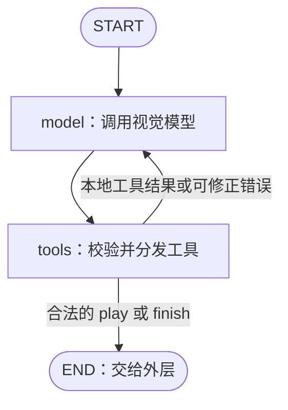

# VISTA：视觉、动作与记忆

本目录将 VISTA 的视觉工具与记忆机制接入 MuJoCo 移动机械臂。模型根据车头图像和机器人实测状态，提出动作预期、提交动作、检查结果，再把经过验证的经验写进笔记。成功示范由外层采集器导出为 ACT 训练数据。

实现使用 **OpenAI 兼容 Chat Completions 接口 + 两节点 LangGraph**。模型可回看图片、检查局部、读取像素和查询历史；`play` 将动作批次交给采集器，`finish` 请求结束任务。整个 episode 延续完整消息历史，不做自动上下文压缩或语义图片检索。

## 文件布局

```text
brains/vista/
├── __init__.py
├── base.py
├── brain.py
├── graph.py
├── state.py
├── model.py
├── tools.py
├── storage.py
├── settings.py
├── prompts/
│   └── system.txt
├── README.md
└── README_log.md
```

| 文件 | 职责 |
| --- | --- |
| `base.py` / `__init__.py` | `Brain`、`Decision` 接口与 `VistaBrain` 导出 |
| `brain.py` | episode 生命周期、消息延续、图调用、动作交接和回执接收 |
| `graph.py` | `model` / `tools` 节点及条件边 |
| `state.py` | 两个图状态字段，以及工具请求、动作回执和消息配对约定 |
| `model.py` | 模型请求、工具绑定、文本与图片消息转换、回复解析 |
| `tools.py` | 九个工具的 Schema、参数校验与顺序分发 |
| `storage.py` | 原始 PNG、帧索引、笔记和运行日志的读写 |
| `settings.py` | 调用预算、工具数量、图片尺寸及字符数限制 |
| `prompts/system.txt` | 任务、相机、机器人动作与查证方法的系统提示词 |
| `README_log.md` | 原设计文档与修订记录的完整归档 |

外层 [run_collect.py](../../run_collect.py) 管理任务和数据记录，[control/tools.py](../../control/tools.py) 执行动作并推进仿真。迁移环境时，主要替换观察入口、动作定义与执行器、任务提示词；消息循环和图片/笔记管理可沿用。

## 配置与运行

在项目根目录安装 `requirements.txt`，将 `.env.example` 复制为 `.env` 并填写模型配置。端点必须同时支持**图片输入和工具调用**；使用 `stream=false`，设置正整数 `max_model_calls`。进程环境变量优先于 `.env`。

```bash
python run_collect.py --brain vista --gui --episodes 5 --seed 0 --max-decisions 64 --out data/episodes/run_001 --brain-memory output/vista/run_001 --dataset-out data/act_v1
```

| 参数 | 作用 |
| --- | --- |
| `--episodes` / `--seed` | 集数与首集场景 seed；后续 episode 的 seed 逐次递增 |
| `--max-decisions` | 每集外层决策次数上限，每次决策交出一个 `play` 或 `finish` |
| `.env` 中的 `max_model_calls` | 每次 `decide()` 内部的模型请求次数上限，工具错误后的再请求也计数 |
| `--out` | 通用采集轨迹、图片和元数据目录 |
| `--brain-memory` | VISTA 图片、笔记和日志目录；默认 `output/vista/` |
| `--dataset-out` | 成功集 HDF5 与 manifest 目录；默认 `data/act_v1/`，重复运行追加 |
| `--gui` / `--keep-open` | 显示交互窗口，以及结束后保留窗口 |

云端无窗口运行去掉 `--gui`，按照[根目录环境说明](../../README.md)安装 EGL 库并设置 `MUJOCO_GL=egl`。并行采集进程应使用各自的 `--brain-memory`，避免共同改写指南。

每次模型请求发送一次 POST，不自动重试或切换模型。`OPENAI_BASE_URL` 应包含服务要求的 API 前缀，也可直接指向 `/chat/completions`；接口保留需要回传的 reasoning 字段和原始工具调用。请求失败或回复被截断时停止，避免误执行不完整动作。

## LangGraph：图与状态

### 三层循环

| 层级 | 一次循环做什么 |
| --- | --- |
| 采集器 | 取得观察 → 调用 `decide()` → 执行动作批次 → 提交结果 |
| `VistaBrain` | 保持 episode 上下文，归档观察，调用图，接回动作结果 |
| LangGraph | 请求模型 → 执行本地工具 → 继续请求模型，或交出 `play` / `finish` |

MuJoCo 的执行发生在图外。查图、读像素、读写笔记不推进物理时间；`observe` 是真实动作，会推进仿真。

### 两个节点



`model` 节点检查上一轮工具回执配对，检查调用预算，发送累计消息并追加 `AIMessage`。`tools` 节点校验本轮请求：本地工具顺序执行，各自生成 `ToolMessage`；图片结果另放在图片消息中，所有结果一起交回模型。

合法 `play` / `finish` 必须独占一条模型回复。`tools` 校验后返回空状态更新，末尾仍保留该 `AIMessage`，条件边据此走向 `END`。**此时只是交接请求，动作尚未执行，也没有执行结果。** 外层完成后，`brain.py` 才追加对应调用 ID 的 `ToolMessage`，并在有新观察时追加图片与状态。

### State 的两个字段

```python
class VistaState(TypedDict):
    messages: Annotated[list[AnyMessage], add_messages]
    model_calls: int
```

- `messages`：本 episode 累积的观察、模型请求和工具结果。`add_messages` 按消息 ID 合并；工具调用 ID 负责把请求与回执配对，两者用途不同。
- `model_calls`：本次 `decide()` 已发出的模型请求次数。下一次外层决策将它归零，但保留消息历史。

模型客户端、图片索引、存储目录和 MuJoCo 对象不放进 State。`VistaBrain` 在内存中持有状态，不使用 LangGraph checkpointer；`messages.jsonl` 用于追溯，不是自动恢复运行中的物理任务的入口。

一次模型回复可以包含多个本地工具请求，执行顺序与请求顺序一致。只有全部结果返回后，模型才发出依赖这些结果的新请求。每轮检查当前回复的调用 ID 和回执，不另建一套待办工具队列。

## 观察与图片证据

模型看到的是车头 RGB 和同一采样时刻的五维 `observation`：

| 字段 | 含义与单位 |
| --- | --- |
| `shoulder_rad` / `elbow_rad` | 肩、肘实测角度，rad |
| `gripper_opening` | 实测连续开度，0 闭、1 开，保留中间值 |
| `base_v_mps` | 车体前向速度，m/s |
| `base_w_radps` | 车体转向角速度，rad/s，正值为左转 |

`timestamp_s` 为仿真采样时间。实测状态与动作目标分别记录，模型不接收球或箱子的真值坐标。原图及 ACT 图像不添加参考线或标记。

```text
O0 → play A → O1 → play B → O2
```

A 的结束观察和 B 的开始观察共用 O1 的 `frame_id`。下一次 `decide()` 校验该观察，不重复拍照；`inspect` 回看旧图也不会改变当前帧。每次 API 请求携带累计历史，包括旧观察，但这不表示重新采样。

帧编号在一个 episode 内唯一。`inspect` 的区域和 `read_pixels` 的坐标始终对应原图：左上角为原点，x 向右、y 向下。`region` 是含 `x, y, width, height` 的对象，区域为 `[x,x+width) × [y,y+height)`，不包含右边界和下边界。

## 九个工具

| 工具 | 参数 | 用途 |
| --- | --- | --- |
| `inspect` | `question, views` | 回看指定帧的整图或局部；每个 view 指定 `label, frame_id`，可选 `region` |
| `read_pixels` | `question, views` | 按区域网格读取原始 RGB；每个 view 指定 `label, frame_id, region, rows, columns` |
| `history` | 可选 `start_batch, end_batch, limit` | 查询已结算动作批次及其前后帧 |
| `read_guide` | 无 | 读取跨 episode 的环境经验 |
| `write_guide` | `content` | 完整替换环境指南 |
| `read_working` | 无 | 读取本 episode 的计划、假设和未决问题 |
| `write_working` | `content` | 完整替换本集草稿 |
| `play` | `actions, expectation, basis_frame_id` | 提交一批连续执行的动作 |
| `finish` | `success, reason`，可选 `evidence_frame_ids` | 请求结束任务，并给出模型自评及证据 |

### 查看图片和历史

`inspect` 返回真实图片及原始尺寸、选区、展示尺寸、时间和实测状态。派生展示图采用最近邻缩放，默认长边 1024 像素；不修改归档 PNG，也不把裁图注册成新环境帧。`question` 记录检查目的，工具本身不回答视觉问题。

`read_pixels` 在网格单元中心采样，返回原图坐标和 RGB；不做物体识别、分割或成功判断。默认每次最多 4 个 view、总计 1024 个采样点。区域越界或参数超限返回错误，不静默裁剪。

`history` 的批次范围包含两端，默认返回筛选范围内最近 10 条、最多 50 条，按批次编号升序排列。结果包含动作、预期、执行结果、前后帧和执行前实测状态；截取返回条数时说明范围，不删除原始记录。当前帧即使尚未出现在已结算批次中，也可通过 `inspect` 查看。

### 两份笔记

`guide.md` 保存适用于同一环境设定的稳定经验，跨 episode 保留；`working.md` 每集新建，保存当前计划、待验证假设、矛盾和相关帧。初始请求主动读入两份笔记，后续由模型按需读写。

两个写工具都做**完整替换**，需要保留的内容必须包含在新文本中；默认上限分别为 8000 和 4000 字符。没有自动摘要或自动更新笔记：执行后是否修订假设、是否将经验写入指南，由模型根据回执和图像决定。更换相机、控制参数或任务设定时，应检查指南适用性或使用新的记忆目录。

### `play`：动作批次与预期

```json
{
  "actions": [
    {"action": "arm_pose", "args": {"pose": "reach"}},
    {"action": "close_gripper", "args": {}},
    {"action": "close_gripper", "args": {}},
    {"action": "arm_pose", "args": {"pose": "carry"}}
  ],
  "expectation": "球随夹爪抬起，批次结束后仍能在两指附近看到球。",
  "basis_frame_id": "f000005"
}
```

`actions` 默认允许 1–16 项，整批校验通过后才交接，按数组顺序执行。`expectation` 描述整批结束后预期看到的变化；`basis_frame_id` 必须是当前帧，防止把回看的旧图当作当前状态。批内没有模型重规划，只在批末交回新图。

| 动作 | 参数 | 行为 |
| --- | --- | --- |
| `forward` / `back` | `seconds`，默认 1.0，范围 0.1–3.0 | 前进 / 后退 |
| `turn_left` / `turn_right` | 同上 | 原地转向；秒数换算为目标转角，实际耗时由控制器决定 |
| `arm_pose` | `pose`: `stow/reach/carry/drop` | 机械臂预设姿态 |
| `shoulder` / `elbow` | `delta`，范围 ±0.5 rad | 相对当前实测角进行单关节微调 |
| `open_gripper` | `{}` | 张爪，固定 0.8 秒 |
| `close_gripper` | `{}` | 闭爪并检查稳定夹持，固定 1.2 秒 |
| `observe` | `{}` | 停底盘、保持臂和夹爪目标，推进 0.8 秒后观察 |

姿态在根目录 `config.py` 标定，肩/肘角度依次为：`stow=[0,2.2]`、`reach=[1.1414,1.4639]`、`carry=[0.95,1.10]`、`drop=[0.5161,2.0053]`。抓取参考是 stow 姿态下 320×240 原图中球心约 `(160,110)`、直径约 44 px；参考只用于接近，抬起后仍须验球。更完整的任务指导见 [system.txt](prompts/system.txt)。

闭爪期间停止底盘、保持臂目标，固定执行 12 个控制拍。确认夹持要求同一球连续 0.1 秒接触两侧指垫内面，开度在 0.05–0.45 且波动不超过 0.02；`completed` 表示动作结束时仍确认夹持，不等于任务完成。未确认返回 `GRASP_NOT_CONFIRMED`。

抓取提示要求同批连续两次闭爪。首次未确认时允许紧邻的第二次继续；第二次仍失败则停止后续动作。首次失败、第二次成功时仍保留首项失败和批次 `partial`。动作结束或异常时关闭新抓取判定，后续等待或抬臂不会延迟吸附。

投放使用普通动作：carry 持球并朝向箱口 → 切换较短的 drop 并前进接近箱壁 → 看图确认持球及落点 → 另批开爪并 observe。drop 比 carry 收回约 25 cm，需要重新估计距离。控制层不提供箱壁接触、朝向或居中判定；不能仅凭图像重叠推断球已在箱内。

### 结果与错误

本地工具结果统一包含 `ok, data, error`；错误说明 `code, message, can_retry, hint`。`can_retry` 表示模型可以修正请求后重试，不表示程序自动重发。

默认每条回复最多 8 个工具调用，`play` / `finish` 必须单独出现。超限或混合交接工具时整组拒绝；普通参数错误返回匹配调用 ID 的结果，让模型修正。动作数组完整校验，后项无效时也不会提前执行前项。

实际动作结果区分 `completed / failed / unknown / not_executed`，并记录 `action_applied=true / false / null`。批次保留每项事实和最终状态；进度明确的控制失败可带新图交回模型，进度未知、消息无法配对或关键文件读写失败则终止，不重复执行来猜测结果。正常失败后默认停止剩余子动作，连续闭爪对的第一次未确认是上述特例。

`finish` 记录模型自评、原因和证据帧，由外层接受并结算。最终成功由环境独立判断；模型声称成功不直接决定是否导出训练示范。普通任务失败会结算该集并继续请求的后续 episode；全部结束后如有失败，采集命令返回退出码 1。运行错误则停止整个采集进程。

## 运行文件与数据衔接

```text
output/vista/
├── guide.md
└── ep_0000/
    ├── working.md
    ├── frames/
    │   ├── f000000.png
    │   └── ...
    ├── frame_index.jsonl
    ├── actions.jsonl
    ├── calls.jsonl
    ├── messages.jsonl
    └── outcome.json
```

| 文件 | 内容 |
| --- | --- |
| `frames/` / `frame_index.jsonl` | 初始及批次结束原图；编号、路径、尺寸、来源批次、时间和实测状态 |
| `actions.jsonl` | 每个已结算 `play` 一条；请求、预期、结果、前后帧及执行前状态 |
| `calls.jsonl` | 工具请求与结果、事件及故障诊断 |
| `messages.jsonl` | 对话轨迹，供人工追溯模型收到的证据和给出的请求 |
| `outcome.json` | 本集结局和外层评分，不作为模型输入 |

VISTA 按动作批次保存决策证据；通用采集器按 **10 Hz 控制拍**保存训练图像、状态和动作。一个批次通常对应多个训练样本。两个目录各自分配 episode 编号，通过记录中的来源路径关联，不要求编号相同。

HDF5、manifest、完整成功集筛选与中断恢复见[根目录 README](../../README.md)。ACT 的划分和读取见 [ACT README](../../act/README.md)。

## 测试

```bash
python -m pytest tests/test_vista.py -q
```

测试使用模拟模型检查消息配对、工具边界、图片与状态、动作交接和故障处理；仿真用例运行真实 MuJoCo 控制器，需要图形后端。协议测试与真实模型的任务成功率分别评估。

## 参考

- [VISTA 原仓库](https://github.com/joshhhhhan/VISTA)
