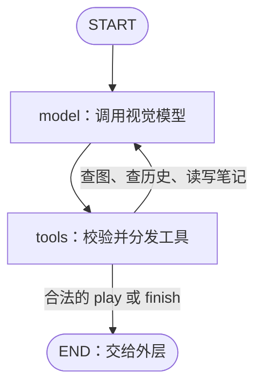

# VISTA：视觉、动作与记忆

本目录将 VISTA 的视觉工具与记忆机制接入 MuJoCo 移动机械臂。模型根据车头图像和机器人实测状态，提出动作预期、提交动作、检查结果，再把经过验证的经验写进笔记。成功示范由外层采集器导出为 ACT 训练数据。

实现使用 **OpenAI 兼容 Chat Completions 接口 + 两节点 LangGraph**。模型可回看图片、检查局部、读取像素和查询历史；`play` 将动作批次交给采集器，`finish` 请求结束任务。整个 episode 延续完整消息历史，不做自动上下文压缩或语义图片检索。

## 配置与运行

先按[主 README](../../README.md#环境安装)完成 AutoDL/Linux 环境安装。以下命令均在项目根目录执行。

首次执行 `cp -n .env.example .env`，填写以下配置。模型服务须同时支持图片输入与工具调用，进程环境变量优先于 `.env`。

| 配置 | 用途 |
| --- | --- |
| `OPENAI_API_KEY` | 模型服务密钥 |
| `OPENAI_BASE_URL` | OpenAI 兼容接口地址 |
| `OPENAI_MODEL` | 使用的视觉模型 |
| `stream=false` | 使用完整响应 |
| `max_model_calls=12` | 一次 `decide()` 内最多请求模型 12 次 |

```bash
export MUJOCO_GL=egl
python -u run_collect.py \
  --brain vista --episodes 100 --seed 0 --workers 4 --max-decisions 64 \
  --out data/episodes --brain-memory output/vista --dataset-out data/act_v1
```

采集 seed 0–99，共 100 集，最多 4 集并行；`--max-decisions` 是每集的外层决策次数上限。再次追加时使用新的 seed，已有 episode 目录不会覆盖。成功示范追加到 `data/act_v1`。

并行进程共享 `output/vista/guide.md`，每集的图片、草稿与日志存入独立的 `ep_NNNN/`。共享指南通过文件锁和版本检查协调更新，可以使用同一个记忆根目录。

## LangGraph：看图、查证、交出动作

图只有两个节点：`model` 调用视觉模型，`tools` 校验并处理工具请求。



查图与笔记工具直接返回结果，让模型继续思考。`play` 和 `finish` 必须各自独占一条模型回复；合法请求会结束本次图调用，交给采集器处理。**MuJoCo 动作在图外执行，查图和读写笔记不推进仿真。**

图状态只有 `messages` 和 `model_calls`：前者保留本集完整消息，后者统计本次决策的模型请求数。下一次 `decide()` 重置计数，继续沿用消息历史。工具参数错误会反馈给模型修正；实际执行结果由外层返回。

## 工具

模型一共可调用九个工具，分为查证、记忆和执行三组。

### 查图与历史

| 工具 | 主要输入 | 返回内容 |
| --- | --- | --- |
| `inspect` | `question`、`views`；每个 view 指定 `label`、`frame_id`，可选 `region` | 指定帧的整图或局部，以及该帧的实测状态；工具提供图片，由模型判断 |
| `read_pixels` | `question`、`views`；每个 view 指定 `label, frame_id, region, rows, columns` | 在区域网格中心采样的原图坐标与 RGB，不做物体识别 |
| `history` | `mode`、`start`、`end`；按帧查询还可指定 `step` | `batch` 模式返回动作批次和执行记录；`frame` 模式返回指定帧的状态与编号 |

每个 episode 从 `f000000` 开始按 10 Hz 归档，帧号相差 10 表示经过 1 秒仿真时间。模型只接收车头图像和五维实测状态，不接收球、箱子的真值坐标。

`region` 使用原图坐标 `{x, y, width, height}`，左上角为原点，x 向右、y 向下。回看旧图不会改变当前帧；`history` 只返回记录，需要看图时再用返回的 `frame_id` 调用 `inspect`。查询结果过长时可按 `next_query` 继续读取。

### 两份记忆

| 工具 | 输入 | 作用 |
| --- | --- | --- |
| `read_guide` | 无 | 读取跨集共享经验及其 `revision` |
| `write_guide` | `content, base_revision` | 完整替换共享指南；版本冲突时先重读、合并，再提交 |
| `read_working` | 无 | 读取本集计划、假设和待确认事项 |
| `write_working` | `content` | 完整替换本集草稿 |

`guide.md` 跨 episode 保留，`working.md` 每集新建。两个写工具都是**完整替换**，要保留的内容必须写入新文本。每次模型请求前检查共享指南版本，有变化就将新版加入上下文。

### 执行与结束

**`play(actions, expectation, basis_frame_id)`** 提交一批顺序执行的动作。`expectation` 描述整批结束后预期看见的变化；`basis_frame_id` 必须是当前帧。整批参数校验通过后才交给外层，批内不调用模型，结束或停止后返回回执与新观察。

```json
{
  "actions": [
    {"action": "turn_left", "args": {"seconds": 0.3}},
    {"action": "observe", "args": {"seconds": 0.2}}
  ],
  "expectation": "车体向左转动后停下，比较球在车头图像中的位置变化。",
  "basis_frame_id": "f000005"
}
```

`play` 可使用外层 [control/tools.py](../../control/tools.py) 提供的全部十个控制动作：

| 动作 | 参数 | 行为 |
| --- | --- | --- |
| `forward` / `back` | `seconds`，默认 1，范围 0.1–3 | 底盘前进 / 后退 |
| `turn_left` / `turn_right` | `seconds`，默认 1，范围 0.1–3 | 原地左转 / 右转；按名义秒数换算目标转角，实际耗时由控制器决定 |
| `arm_pose` | `pose`：`stow / reach / carry / drop` | 空爪收纳 / 地面抓取 / 抬高携带 / 短前伸投放；只改变臂目标 |
| `shoulder` / `elbow` | `delta`，范围 ±0.5 rad | 相对当前实测角微调肩 / 肘 |
| `open_gripper` | `{}` | 张开夹爪，释放物体 |
| `close_gripper` | `{}` | 停止底盘并闭爪，等待稳定夹持确认 |
| `observe` | `seconds`，默认 0.1，范围 0.1–3 | 停止底盘、保持臂爪目标并推进仿真；稳定时可提前结束等待 |

抓取时，同一个 `play` 连续提交两次 `close_gripper`。首次未确认允许紧邻的第二次继续，第二次仍失败则停止后续动作；抬臂后仍需看图验球。普通控制失败会停止该批剩余动作，将实际结果交回模型。具体场景的抓取与投放要求见 [prompts/system.txt](prompts/system.txt)。

**`finish(success, reason, evidence_frame_ids)`** 请求结束当前 episode，证据帧可省略。`success` 是模型自评，最终成功由环境独立判断。外层的 `done` 接口在 VISTA 中通过 `finish` 交接，不属于 `play` 的动作。

## 文件布局

```text
brains/vista/
├── README.md              # 配置、工具、图与外层调用说明
├── __init__.py            # 导出 VistaBrain，供采集器加载
├── base.py                # Brain 接口与 Decision 数据结构
├── brain.py               # episode 生命周期、decide、动作交接和结果接收
├── graph.py               # model / tools 两节点及条件边
├── state.py               # 消息状态、工具调用与批次回执规则
├── model.py               # HTTP 模型请求、图像消息和回复解析
├── tools.py               # 九个工具的 Schema、参数校验和本地执行
├── storage.py             # 帧归档、动作记录、共享指南、本集草稿与日志
├── settings.py            # 模型调用预算及工具、存储配置
└── prompts/system.txt     # 当前实际使用的任务与操作提示词
```

`run_collect.py` 负责采集调度，`control/tools.py` 执行机器人动作，`recorder.py` 保存原始轨迹并导出成功示范。VISTA 运行记录保存在 `output/vista/`：共享 `guide.md`，每集保存 `working.md`、`frames/`、`actions.jsonl`、`calls.jsonl`、`messages.jsonl` 和 `outcome.json`。

## 外层调用逻辑

```text
begin_episode(...)：创建本集存储，初始化消息与工具
    ↓
decide(当前观察, ...)：图内查证与思考，交出 play
    ↓
采集器顺序执行动作，按 10 Hz 采样并记录
    ↓
accept_batch_result(执行回执, 观测窗口)
    ↓
归档过程帧，将对应 ToolMessage、批末图像和状态加入上下文
    ↓
decide(新的当前观察, ...)：继续检查、行动
    ↓
finish → accept_finish_result(...) → 收尾仿真与环境评分 → end_episode(...)
```

`accept_batch_result()` 负责接收结果，不重新执行动作。新一轮 `decide()` 必须等上批回执处理完成，才能基于真实执行结果继续决策。模型在批末看到当前图，也可用工具回看过程帧。

环境判定成功或达到决策上限时，也可由采集器直接结束循环。正常结束后停止底盘、继续仿真 3 秒再评分；只有完整成功集进入 ACT 数据。数据目录和 HDF5 格式见[主 README](../../README.md#数据采集与格式)。

## 参考

[VISTA 原仓库](https://github.com/joshhhhhan/VISTA)。本项目将其视觉查证与记忆思路接入 MuJoCo，工具协议和执行流程以本仓库实现为准。
